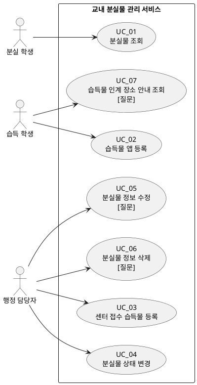

# 소프트웨어 요구사항 명세서(SRS) v0.1

## 1. 문서 개요

| 항목 | 내용 |
| --- | --- |
| 대상 서비스 | 교내 분실물 관리 서비스 |
| 버전 | v0.1 |
| 기준 문서 | [고객 요구사항.md](고객%20요구사항.md) |
| 목적 | 고객 요구사항을 기능 요구사항, 비기능 요구사항 및 정책으로 구체화한다. |
| 문서 상태 | 초안. `결정 필요` 항목은 이해관계자 확인 후 확정한다. |

## 2. 기능 요구사항

| ID | 기능 요구사항 | 우선순위 | 수용 기준 | 근거 및 미결 사항 |
| --- | --- | --- | --- | --- |
| FR_01 | 서비스는 학생이 분실물의 보관 여부를 조회할 수 있도록 해야 한다. | 필수 | 등록된 물품에 대해 조회 결과가 표시되어 보관 여부를 확인할 수 있다. | NEEDS_1, SC1, S1. 검색 조건은 결정 필요. |
| FR_02 | 서비스는 조회 결과에 물품의 보관 위치를 표시해야 한다. | 필수 | 조회 결과에서 물품의 보관 위치를 확인할 수 있다. | NEEDS_1, SC1, S1. 위치의 상세 수준과 공개 범위는 결정 필요. |
| FR_03 | 서비스는 조회 결과에 보관 담당 부서와 문의 방법을 표시해야 한다. | 필수 | 학생이 담당 부서와 안내된 문의 경로를 확인할 수 있다. | NEEDS_4, SC6, S5. 부서명, 연락 경로 및 안내 문구는 결정 필요. |
| FR_04 | 습득 학생은 자신이 습득한 물품 건을 앱에서 직접 등록할 수 있어야 한다. | 필수 | 습득 학생이 물품 정보를 입력해 저장하면, 저장된 물품이 조회 및 관리 대상이 된다. | DEC_01. 입력 필드, 필수값 및 등록 후 검토 절차는 결정 필요. |
| FR_05 | 행정 담당자는 분실물 센터에 접수된 습득 물품 정보를 등록할 수 있어야 한다. | 필수 | 행정 담당자가 신규 물품 정보를 저장하면, 저장된 물품이 조회 및 관리 대상이 된다. | NEEDS_2, SC2, S2, DEC_02. 입력 필드, 필수값 및 등록 권한은 결정 필요. |
| FR_06 | 행정 담당자는 물품 상태를 보관 중 또는 인도 완료로 기록하고 구분할 수 있어야 한다. | 필수 | 저장된 상태가 관리 화면과 조회 결과에서 구분되며, 인도 완료 물품을 보관 중 물품과 식별할 수 있다. | NEEDS_3, SC3, S2. 상태 변경 권한, 정정 절차 및 조회 노출 방식은 결정 필요. |
| FR_07 | 서비스는 등록된 분실물 정보를 관리할 수 있어야 한다. | 결정 필요 | 수정·삭제 필요 여부, 처리 주체 및 수용 기준을 정한 후 확정한다. | SC2, SC3. 원문은 등록과 상태 관리를 요구하며 수정·삭제 방식은 명시하지 않음. |
| FR_08 | 서비스는 습득 학생을 위한 물품 인계 장소 안내 제공 여부를 결정해야 한다. | 결정 필요 | 기존 안내의 유무와 서비스 내 안내 제공 여부를 확정한 뒤 동작 및 수용 기준을 정한다. | NEEDS_5, SC4, S3. 고객 문서에서 포함 여부 미정. |

## 3. 비기능 요구사항

### 3.1 품질 요구사항

| ID | 품질 특성 | 요구사항 | 측정 또는 수용 기준 | 근거 및 미결 사항 |
| --- | --- | --- | --- | --- |
| NFR_01 | 사용성 | 학생은 행정실 방문 전에 보관 여부, 위치 및 문의 방법을 이해할 수 있어야 한다. | 학생이 조회 결과에서 세 정보를 식별할 수 있는지 사용성 검토로 확인한다. 구체적인 목표치는 결정 필요. | NEEDS_1, NEEDS_4, S1, S5 |
| NFR_02 | 사용성·효율성 | 습득 학생의 앱 등록과 행정 담당자의 센터 접수 등록은 각 사용자의 업무 부담을 줄이는 방향으로 설계해야 한다. | 등록 유형별 현재 소요 시간, 부담 요인, 측정 방법 및 개선 목표를 정한 뒤 기준선과 목표 달성 여부를 평가한다. | NEEDS_7, S2, DEC_01, DEC_02. 현재 수치와 목표가 미정. |
| NFR_03 | 정보보호 | 조회 화면에는 목적 달성에 필요한 정보만 표시해야 하며 담당자의 개인 휴대전화 번호를 공개해서는 안 된다. | 정보보호 담당자와 운영 책임자가 공개 항목을 검토하고, 개인 휴대전화 번호가 표시되지 않는지 확인한다. | NEEDS_6, SC8, S4, C_1 |
| NFR_04 | 정보보호 | 서비스는 실제 개인정보를 사용하지 않고 가상 데이터로 동작해야 하며, 학교 인증 연동을 포함하지 않아야 한다. | 구현·시연 데이터가 가상 데이터인지, 학교 인증 시스템 연계가 없는지 확인한다. | C_1 |
| NFR_05 | 정확성 | 조회 결과는 등록된 물품 정보와 현재 기록된 상태에 일치해야 한다. | 물품 등록 또는 상태 변경 후 조회 결과가 저장된 값과 일치하는지 확인한다. 허용 갱신 시간은 결정 필요. | SC1, SC2, SC3 |
| NFR_06 | 접근성·호환성 | 학생과 행정 담당자가 사용할 지원 기기·브라우저 및 접근성 기준을 정해야 한다. | 지원 환경과 준수 기준을 결정한 뒤 해당 환경에서 확인한다. | 추가 고객 확인 필요. |
| NFR_07 | 성능 | 조회 및 등록의 응답 시간 목표를 정해야 한다. | 예상 동시 사용자, 데이터 규모 및 응답 시간 목표를 합의한 뒤 대표 환경에서 측정한다. | 추가 고객 확인 필요. |
| NFR_08 | 가용성·운영성 | 서비스 운영 시간, 장애 대응 및 백업·복구 기준을 정해야 한다. | 실제 운영 책임자와 운영 목표를 정하고, 기준에 따른 운영 점검 절차를 정의한다. | 운영 책임자의 실제 담당자 지정 필요. |

### 3.2 범위 및 제약 요구사항

| ID | 분류 | 요구사항 | 수용 기준 | 근거 |
| --- | --- | --- | --- | --- |
| NFR_09 | 데이터 제약 | 개발·시연에는 가상 데이터만 사용해야 한다. | 실제 개인정보 없이 가상 데이터로 기능을 시연한다. | C_1 |
| NFR_10 | 연동 제약 | 이번 버전은 학교 인증 연동을 제공하지 않는다. | 학교 인증 시스템 연계 기능이 구현 범위에 포함되지 않는다. | C_1 |
| NFR_11 | 범위 제약 | 사진 업로드 및 사진 기반 유사 분실물 조회를 제공하지 않는다. | 사용자가 사진을 올려 물품을 매칭하는 흐름이 이번 버전에 없다. | SC5 |
| NFR_12 | 범위 제약 | 사진 매칭 결과에 따른 자동 알림을 제공하지 않는다. | 수신자 정보 등록 및 알림 발송 흐름이 이번 버전에 없다. | SC7 |

## 4. 정책

| ID | 정책명 | 정책 내용 | 상태 및 결정 주체 | 근거 |
| --- | --- | --- | --- | --- |
| Pol_01 | 데이터 사용 정책 | 개발·시연에는 가상 데이터만 사용하고, 실제 개인정보와 학교 인증 연동은 다루지 않는다. | 확정 | C_1 |
| Pol_02 | 연락처 공개 정책 | 담당자의 개인 휴대전화 번호는 공개하지 않는다. 대신 보관 담당 부서의 문의 방법을 안내한다. | 확정 | NEEDS_4, NEEDS_6, SC6, SC8, S4, S5 |
| Pol_03 | 조회 공개 항목 정책 | 조회 목적에 필요한 공개 정보와 보관 위치의 상세 수준을 정한다. | 결정 필요. 정보보호 담당자 검토, 운영 책임자 결정 | NEEDS_1, NEEDS_6, SC1, S4 |
| Pol_04 | 물품 등록 정책 | 습득 학생은 앱에서 자신이 습득한 물품을 직접 등록하고, 행정 담당자는 분실물 센터 접수 물품을 등록한다. 각 등록 유형의 필수 항목, 입력 형식 및 등록 후 검토 절차를 정한다. | 등록 주체와 등록 대상은 확정. 세부 입력·검토 절차는 결정 필요. | DEC_01, DEC_02, NEEDS_2, SC2, S2 |
| Pol_05 | 상태 관리 정책 | 보관 중에서 인도 완료로 변경하는 권한, 처리 절차 및 잘못 기록된 상태의 정정 절차를 정한다. | 결정 필요. 행정 담당자 및 운영 책임자 확인 | NEEDS_3, SC3, S2 |
| Pol_06 | 인도 완료 정보 노출 정책 | 인도 완료 물품을 학생 조회 결과에 계속 표시할지, 일정 기간 뒤 숨길지 정한다. | 결정 필요 | NEEDS_3, SC3 |
| Pol_07 | 습득물 인계 정책 | 습득물을 맡길 장소를 서비스에서 안내할지, 기존 안내를 활용할지 정한다. | 결정 필요. 학교 운영 측 확인 | NEEDS_5, SC4, S3 |
| Pol_08 | 운영 책임 정책 | 서비스 정책 승인, 공개 정보 결정 및 운영 관리를 담당할 실제 책임자 또는 부서를 지정한다. | 결정 필요. 고객 문서에서 역할은 있으나 실제 담당자 미확정 | 이해관계자 표 |
| Pol_09 | 사진 기능 범위 정책 | 사진 기반 조회·매칭과 그 결과의 자동 알림은 이번 버전에서 제외하고, 후속 개선 후보로 둔다. | 확정 | SC5, SC7 |

## 5. 미결 사항

| ID | 결정할 내용 | 확인 대상 | 영향받는 요구사항 |
| --- | --- | --- | --- |
| TBD_01 | 조회 검색 조건, 검색 결과 정렬 및 결과 없음 처리 방식 | 분실 학생, 행정 담당자 | FR_01, NFR_01 |
| TBD_02 | 조회 결과 공개 필드와 보관 위치의 상세 수준 | 정보보호 담당자, 운영 책임자 | FR_02, NFR_03, Pol_03 |
| TBD_03 | 습득 학생의 앱 등록과 행정 담당자의 센터 접수 등록에 필요한 필수 필드, 입력 검증 및 등록 후 검토 절차 | 습득 학생, 행정 담당자, 운영 책임자 | FR_04, FR_05, Pol_04 |
| TBD_04 | 인도 처리 권한, 상태 정정 절차 및 인도 완료 물품의 조회 노출 기간 | 행정 담당자, 운영 책임자 | FR_06, Pol_05, Pol_06 |
| TBD_05 | 문의 부서명, 연락 경로 및 안내 문구 | 행정 담당자, 운영 책임자 | FR_03, Pol_02 |
| TBD_06 | 습득물 인계 장소 안내의 제공 여부와 안내 위치 | 습득 학생, 학교 운영 측 | FR_08, Pol_07 |
| TBD_07 | 습득 학생과 행정 담당자별 등록 업무 부담의 기준선, 측정 방법 및 개선 목표 | 습득 학생, 행정 담당자, 운영 책임자 | NFR_02 |
| TBD_08 | 성능, 가용성, 지원 환경 및 접근성 목표 | 운영 책임자, 정보보호 담당자 | NFR_06, NFR_07, NFR_08 |

## 6. 추적성 참고

`NEEDS_*`, `SC*`, `S*`, `C_1`은 [고객 요구사항.md](고객%20요구사항.md)의 고객 요구사항 요약, 개발 범위와 공통 제약, 고객 인터뷰를 가리킨다. 이 문서의 수용 기준은 검토 가능한 형태로 정리한 것이며, `결정 필요` 항목은 별도 합의 전까지 확정된 약속으로 해석하지 않는다.

## 7. 원문 근거와 항목 상태

| 구분 | 의미 | 적용 방식 |
| --- | --- | --- |
| 확정 | 고객 요구사항 또는 고객이 추가로 확정한 결정에 근거한다. | 개발과 검증의 기준으로 사용한다. |
| 질문 | 원문에 결정되지 않은 조건·정책이 있다. | 고객 답변 전에는 해당 세부 동작을 구현 기준으로 확정하지 않는다. |
| 제안 | 원문에 수치가 없어 검증을 위해 일반 기준을 제시한다. | 고객 승인 후 확정 요구사항으로 전환한다. |

| 원문 근거 | SRS 반영 항목 | 상태 | 남은 결정 |
| --- | --- | --- | --- |
| NEEDS_1, SC1, S1 | FR_01, FR_02, UC_01 | 확정 | 검색 조건, 보관 위치 공개 수준 |
| NEEDS_2, SC2, S2, DEC_02 | FR_05, UC_03 | 확정 | 등록 입력 필드, 검토 절차 |
| NEEDS_3, SC3, S2 | FR_06, UC_04 | 확정 | 상태 변경 권한, 정정, 인도 완료 노출 |
| NEEDS_4, SC6, S5 | FR_03, UC_01 | 확정 | 담당 부서명, 문의 경로, 표시 문구 |
| DEC_01 | FR_04, UC_02 | 확정 | 습득 학생 등록 후 공개·검토 절차 |
| NEEDS_5, SC4, S3 | FR_08, UC_07 | 질문 | 서비스 내 인계 장소 안내 제공 여부 |
| NEEDS_6, SC8, S4, C_1 | NFR_03, Pol_02, Pol_03 | 개인 번호 비공개는 확정 | 나머지 공개 항목과 위치 상세 수준 |
| NEEDS_7, S2 | NFR_02 | 질문 | 현재 등록 시간, 측정 방법, 개선 목표 |
| SC5, SC7 | NFR_11, NFR_12, Pol_09 | 확정 | 없음 |

## 8. 사용자 목표와 액터

| ID | 액터 | 사용자 목표: 누가 무엇을 하여 어떤 가치를 얻는가 | 상태 |
| --- | --- | --- | --- |
| ACT_01 | 분실 학생 | 분실물을 조회하여 보관 여부·위치·문의 방법을 확인하고, 불필요한 행정실 방문과 반복 문의를 줄인다. | 확정 |
| ACT_02 | 습득 학생 | 습득 물품을 앱에 직접 등록하여 소유자가 물품을 조회하고 찾을 기회를 제공한다. | 확정 |
| ACT_03 | 행정 담당자 | 센터 접수 물품을 등록하고 상태를 바꾸어 보관 물품과 인도 완료 물품을 구분한다. | 확정 |
| STK_01 | 정보보호 담당자 | 조회 화면의 공개 정보 범위를 검토한다. 직접 시스템을 쓰는 액터가 아니라 정책 이해관계자다. | 확정 |
| STK_02 | 서비스 운영 책임자 | 운영 정책과 책임자를 결정한다. 실제 담당자는 아직 정해지지 않았다. | 질문 |

## 9. 유스케이스 목록과 연결표

| ID | UC 명 | 액터 | 목표와 가치 | 연결 요구사항 | 상태 |
| --- | --- | --- | --- | --- | --- |
| UC_01 | 분실물 조회 | 분실 학생 | 보관 여부·위치·문의 방법을 확인해 방문과 반복 문의를 줄인다. | [FR_01](#fr-01), [FR_02](#fr-02), [FR_03](#fr-03) | 확정 |
| UC_02 | 습득물 앱 등록 | 습득 학생 | 습득 물품을 즉시 등록하여 소유자의 조회 기회를 만든다. | [FR_04](#fr-04) | 확정 |
| UC_03 | 센터 접수 습득물 등록 | 행정 담당자 | 센터 접수 물품을 등록해 보관 물품을 관리하고 학생이 조회하게 한다. | [FR_05](#fr-05) | 확정 |
| UC_04 | 분실물 상태 변경 | 행정 담당자 | 보관 중·인도 완료 상태를 구분해 정확한 관리와 안내를 제공한다. | [FR_06](#fr-06) | 확정 |
| UC_05 | 분실물 정보 수정 | 행정 담당자 | 등록 오류 또는 변경을 바로잡는다. | [FR_07](#fr-07) | 질문 |
| UC_06 | 분실물 정보 삭제 | 행정 담당자 | 관리 대상이 아닌 등록 정보를 제거한다. | [FR_07](#fr-07) | 질문 |
| UC_07 | 습득물 인계 장소 안내 조회 | 습득 학생 | 물품을 맡길 장소를 확인해 올바르게 인계한다. | [FR_08](#fr-08) | 질문 |

| 기본 UC | 연결 | 대상 UC | 관계와 검증 관점 |
| --- | --- | --- | --- |
| UC_02 | 선행 조건 | UC_01 | 습득 학생이 등록한 물품은 조회 대상이 된다. |
| UC_03 | 선행 조건 | UC_01 | 센터 접수 물품은 등록 후 조회 대상이 된다. |
| UC_04 | 정보 갱신 | UC_01 | 상태 변경 후 조회 결과는 현재 상태를 반영한다. |
| UC_05 | 후속 후보 | UC_02, UC_03 | 수정 기능 제공이 확정되면 등록 정보 변경을 처리한다. |
| UC_06 | 후속 후보 | UC_02, UC_03 | 삭제 기능 제공이 확정되면 관리 대상 제외를 처리한다. |

## 10. UseCase Diagram

## 11. 유스케이스(UC) 명세

### UC_01. 분실물 조회

| 항목 | 명세 |
| --- | --- |
| ID, UC 명, 목표, 액터 | UC_01 / 분실물 조회 / 분실 학생이 보관 여부·위치·문의 방법을 확인해 방문과 반복 문의를 줄인다. / 분실 학생 |
| 출처와 연결 요구사항 | NEEDS_1, NEEDS_4, SC1, SC6, S1, S5 / [FR_01](#fr-01)~[FR_03](#fr-03), Pol_02, Pol_03 |
| 사건 조건, 트리거 | 조회 대상 물품 정보가 등록되어 있다. 분실 학생이 앱에서 조회를 선택한다. |
| 기본 흐름 | 1. 학생이 검색 조건을 입력한다. 2. 시스템이 일치 물품을 조회한다. 3. 시스템이 공개 가능한 보관 여부·위치·문의 방법을 표시한다. |
| 대안 흐름 | A1. 입력 오류 → 오류 항목 표시 → 학생이 수정 후 1단계로 복귀한다. A2. 결과 없음 → 결과 없음 안내 → 조건을 바꾸어 1단계로 복귀하거나 종료한다. [질문] 결과 없음 시 문의 경로도 표시할지 정한다. |
| 예외 흐름 | E1. 조회 처리 실패 → 재시도 방법을 안내 → 재시도하거나 종료한다. |
| 사후 조건, 실패 시 보존 조건 | 성공: 조회 결과만 표시하며 데이터는 변경하지 않는다. 실패·취소: 등록 물품 데이터는 보존한다. [질문] 검색 조건을 다음 조회에 보존할지 정한다. |

### UC_02. 습득물 앱 등록

| 항목 | 명세 |
| --- | --- |
| ID, UC 명, 목표, 액터 | UC_02 / 습득물 앱 등록 / 습득 학생이 물품을 직접 등록해 소유자가 조회할 기회를 만든다. / 습득 학생 |
| 출처와 연결 요구사항 | DEC_01 / [FR_04](#fr-04), Pol_04 |
| 사건 조건, 트리거 | 습득 학생이 등록 기능을 선택한다. 학교 인증 연동은 사용하지 않는다. |
| 기본 흐름 | 1. 학생이 물품 정보를 입력한다. 2. 시스템이 입력값을 검증한다. 3. 학생이 등록을 요청한다. 4. 시스템이 저장하고 완료를 안내한다. |
| 대안 흐름 | A1. 필수값 누락·형식 오류 → 오류 표시 → 수정 후 2단계로 복귀한다. A2. 유사 등록 발견 → 유사 항목 안내 → 계속 등록 또는 취소한다. [질문] 중복 판단 기준을 정한다. |
| 예외 흐름 | E1. 저장 실패 → 재시도 방법을 안내 → 재시도하거나 종료한다. |
| 사후 조건, 실패 시 보존 조건 | 성공: 물품이 조회·관리 대상이 된다. [질문] 즉시 공개 또는 담당자 검토 후 공개를 정한다. 실패: 저장된 물품은 없으며 입력값 임시 보존 여부·기간은 질문이다. 취소: 저장하지 않는다. |

### UC_03. 센터 접수 습득물 등록

| 항목 | 명세 |
| --- | --- |
| ID, UC 명, 목표, 액터 | UC_03 / 센터 접수 습득물 등록 / 행정 담당자가 센터 접수 물품을 등록해 관리와 학생 조회를 가능하게 한다. / 행정 담당자 |
| 출처와 연결 요구사항 | NEEDS_2, SC2, S2, DEC_02 / [FR_05](#fr-05), Pol_04 |
| 사건 조건, 트리거 | 물품이 분실물 센터에 접수되어 행정 담당자가 등록을 시작한다. |
| 기본 흐름 | 1. 담당자가 물품 정보를 입력한다. 2. 시스템이 입력값을 검증한다. 3. 담당자가 저장을 요청한다. 4. 시스템이 저장하고 완료를 안내한다. |
| 대안 흐름 | A1. 입력 오류 → 오류 표시 → 수정 후 2단계로 복귀한다. A2. 기존 등록 의심 → 기존 항목 안내 → 중복 확인 후 등록 또는 취소한다. [질문] 중복 확인 기준과 처리 책임자를 정한다. |
| 예외 흐름 | E1. 저장 실패 → 재시도 방법을 안내 → 재시도하거나 종료한다. |
| 사후 조건, 실패 시 보존 조건 | 성공: 물품이 조회·상태 관리 대상이 된다. 실패·취소: 기존 데이터는 변경하지 않는다. [질문] 임시 입력 보존 여부와 기간을 정한다. |

### UC_04. 분실물 상태 변경

| 항목 | 명세 |
| --- | --- |
| ID, UC 명, 목표, 액터 | UC_04 / 분실물 상태 변경 / 행정 담당자가 상태를 변경해 보관 중과 인도 완료를 구분한다. / 행정 담당자 |
| 출처와 연결 요구사항 | NEEDS_3, SC3, S2 / [FR_06](#fr-06), Pol_05, Pol_06 |
| 사건 조건, 트리거 | 등록 물품이 존재하고 담당자가 상태 변경을 선택한다. 상태 변경 권한은 미정이다. |
| 기본 흐름 | 1. 담당자가 물품을 선택한다. 2. 시스템이 현재 상태를 표시한다. 3. 담당자가 새 상태를 선택한다. 4. 시스템이 상태를 저장·표시한다. |
| 대안 흐름 | A1. 동일 상태 선택 → 현재 상태 안내 → 다른 상태 선택 또는 종료한다. A2. 인도 완료 선택 → 확인 정보 요청 → 확인 후 저장 또는 취소한다. [질문] 확인 정보와 증빙 보관 규칙을 정한다. |
| 예외 흐름 | E1. 권한 없음·저장 실패 → 사유와 재시도 방법 안내 → 재시도, 권한자 요청 또는 종료한다. |
| 사후 조건, 실패 시 보존 조건 | 성공: 새 상태가 조회·관리에 반영된다. 실패·취소: 기존 상태를 보존한다. [질문] 상태 변경 이력의 보존 항목과 기간을 정한다. |

### UC_05. 분실물 정보 수정

| 항목 | 명세 |
| --- | --- |
| ID, UC 명, 목표, 액터 | UC_05 / 분실물 정보 수정 / 행정 담당자가 등록 오류·변경을 바로잡는다. / 행정 담당자 |
| 출처와 연결 요구사항 | SC2, SC3 / [FR_07](#fr-07), Pol_04, Pol_05 |
| 사건 조건, 트리거 | [질문] 수정 기능과 권한이 확정된 뒤 담당자가 오류 또는 변경을 발견한다. |
| 기본 흐름 | 1. 담당자가 물품을 선택한다. 2. 시스템이 현재 정보를 표시한다. 3. 담당자가 정보를 수정한다. 4. 시스템이 검증·저장하고 완료를 안내한다. |
| 대안 흐름 | A1. 입력 오류 → 오류 표시 → 수정 후 검증으로 복귀한다. A2. 인도 완료 물품 수정 → 상태별 규칙 확인 → 허용 시 저장, 미허용 시 종료한다. [질문] 상태별 수정 범위를 정한다. |
| 예외 흐름 | E1. 저장 실패 → 재시도 방법을 안내 → 재시도하거나 종료한다. |
| 사후 조건, 실패 시 보존 조건 | 성공: 수정 정보가 조회·관리에 반영된다. 실패·취소: 기존 정보를 보존한다. [질문] 수정 이력 보존 여부와 기간을 정한다. |

### UC_06. 분실물 정보 삭제

| 항목 | 명세 |
| --- | --- |
| ID, UC 명, 목표, 액터 | UC_06 / 분실물 정보 삭제 / 행정 담당자가 관리 대상이 아닌 등록 정보를 제거한다. / 행정 담당자 |
| 출처와 연결 요구사항 | SC2, SC3 / [FR_07](#fr-07), Pol_04, Pol_05 |
| 사건 조건, 트리거 | [질문] 삭제 기능과 권한이 확정된 뒤 담당자가 삭제할 정보를 선택한다. |
| 기본 흐름 | 1. 담당자가 물품을 선택한다. 2. 시스템이 삭제 대상을 표시한다. 3. 담당자가 삭제를 요청하고 확인한다. 4. 시스템이 삭제 처리하고 완료를 안내한다. |
| 대안 흐름 | A1. 삭제 확인 취소 → 삭제하지 않음 → 물품 상세로 복귀한다. A2. 인도 완료 물품 삭제 → 상태별 규칙 확인 → 허용 시 삭제, 미허용 시 종료한다. [질문] 상태별 삭제 가능 여부를 정한다. |
| 예외 흐름 | E1. 삭제 실패 → 재시도 방법을 안내 → 재시도하거나 종료한다. |
| 사후 조건, 실패 시 보존 조건 | 성공: 조회·관리 대상에서 제외된다. [질문] 물리 삭제 또는 복구 가능한 비활성 처리와 보존 기간을 정한다. 실패·취소: 기존 정보를 보존한다. |

### UC_07. 습득물 인계 장소 안내 조회

| 항목 | 명세 |
| --- | --- |
| ID, UC 명, 목표, 액터 | UC_07 / 습득물 인계 장소 안내 조회 / 습득 학생이 인계 장소를 확인해 물품을 올바르게 맡긴다. / 습득 학생 |
| 출처와 연결 요구사항 | NEEDS_5, SC4, S3 / [FR_08](#fr-08), Pol_07 |
| 사건 조건, 트리거 | [질문] 서비스 내 안내 제공이 확정되고 안내 정보가 등록된 뒤 학생이 안내를 선택한다. |
| 기본 흐름 | 1. 학생이 인계 장소 안내를 선택한다. 2. 시스템이 장소와 안내 정보를 표시한다. 3. 학생이 안내를 확인한다. |
| 대안 흐름 | A1. 안내 정보 없음 또는 운영 시간 외 → 대체 문의 경로 또는 안내 불가를 표시 → 종료한다. [질문] 대체 경로와 운영 시간 외 처리를 정한다. |
| 예외 흐름 | E1. 조회 실패 → 재시도 방법을 안내 → 재시도하거나 종료한다. |
| 사후 조건, 실패 시 보존 조건 | 성공: 학생이 장소 정보를 확인하며 데이터는 변경하지 않는다. 실패·취소: 데이터 변경 없이 오류 안내 또는 종료한다. |

## 12. 제안 목표와 미정 질문

| ID | 구분 | 내용 | 영향 범위 |
| --- | --- | --- | --- |
| PRP_01 | 제안 | 일반 이용 부하에서 조회와 등록 저장 요청의 95%를 3초 이내에 완료한다. | NFR_07 |
| PRP_02 | 제안 | 운영 시간 중 월간 가용률 99% 이상을 목표로 한다. | NFR_08 |
| TBD_01 | 질문 | 조회 검색 조건, 정렬, 결과 없음 처리 | FR_01, UC_01 |
| TBD_02 | 질문 | 공개 필드와 보관 위치의 상세 수준 | FR_02, Pol_03, UC_01 |
| TBD_03 | 질문 | 두 등록 흐름의 필수 입력 필드, 입력 검증, 습득 학생 등록 후 공개·검토 절차 | FR_04, FR_05, Pol_04 |
| TBD_04 | 질문 | 상태 변경 권한, 인도 완료 확인·정정, 인도 완료 정보 노출 | FR_06, Pol_05, Pol_06 |
| TBD_05 | 질문 | 문의 부서명과 표시할 문의 경로 | FR_03, Pol_02 |
| TBD_06 | 질문 | 수정·삭제 제공 여부, 권한, 이력과 보존 규칙 | FR_07, UC_05, UC_06 |
| TBD_07 | 질문 | 인계 장소 안내 제공 여부, 장소, 운영 시간, 책임자 | FR_08, Pol_07, UC_07 |
| TBD_08 | 질문 | 운영 책임자, 운영 시간, 장애 대응·복구 기준 | Pol_08, NFR_08 |
