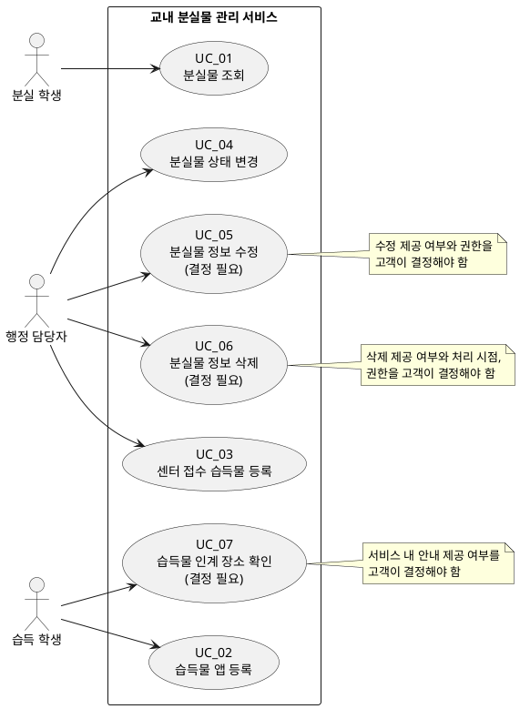

# 유스케이스 명세서(UC) v0.1

## 1. 문서 개요

| 항목 | 내용 |
| --- | --- |
| 대상 서비스 | 교내 분실물 관리 서비스 |
| 기준 문서 | [고객 요구사항.md](고객%20요구사항.md), [SRS_v0.1.md](SRS_v0.1.md) |
| 목적 | 사용자가 무엇을, 왜 하려는지를 기준으로 유스케이스를 식별한다. |
| 상태 | 초안. `결정 필요` 유스케이스는 고객 확인 후 확정한다. |

## 2. 액터 목록

| ID | 액터 | 구분 | 시스템과의 관계 | 목적 |
| --- | --- | --- | --- | --- |
| ACT_01 | 분실 학생 | 주 액터 | 분실물 정보를 조회한다. | 행정실을 방문하기 전에 물품의 보관 여부와 위치를 파악해 불필요한 방문과 반복 문의를 줄인다. |
| ACT_02 | 행정 담당자 | 주 액터 | 분실물 센터에 접수된 습득 물품을 등록하고 보관·인도 상태를 관리한다. | 센터에 접수된 물품 정보를 최신 상태로 유지하고, 이미 인도한 물품을 구분해 문의와 관리 업무를 처리한다. |
| ACT_03 | 습득 학생 | 주 액터 | 자신이 습득한 물품을 앱에서 직접 등록한다. | 습득한 물품 정보를 즉시 등록해 소유자가 조회할 수 있도록 하기 위해서다. 물품 인계 장소 안내의 서비스 제공 여부는 아직 결정되지 않았다. |

정보보호 담당자와 학교 서비스 운영 책임자는 현재 시스템을 직접 사용하는 액터로 식별하지 않았다. 이들은 공개 정보, 권한, 운영 정책을 검토·결정하는 이해관계자다.

## 3. UseCase 목록

| ID | UseCase | 액터 | 사용자 목표 | 사용자가 이 목표를 이루려는 이유 | 상태 | 관련 요구사항 |
| --- | --- | --- | --- | --- | --- | --- |
| UC_01 | 분실물 조회 | 분실 학생 | 잃어버린 물품의 보관 여부, 보관 위치, 담당 부서와 문의 방법을 한 번의 조회로 확인한다. | 행정실 방문 전에 물품을 찾을 수 있는지 판단하고, 같은 물건을 반복해서 문의하거나 방문하는 일을 줄이기 위해서다. | 확정 | NEEDS_1, NEEDS_4, SC1, SC6, FR_01, FR_02, FR_03 |
| UC_02 | 습득물 앱 등록 | 습득 학생 | 자신이 습득한 물품 건을 앱에서 직접 등록한다. | 습득 물품 정보를 즉시 등록하여 소유자가 물품을 조회할 수 있도록 하기 위해서다. | 확정 | DEC_01, FR_04, Pol_04 |
| UC_03 | 센터 접수 습득물 등록 | 행정 담당자 | 분실물 센터에 접수된 습득 물품 정보를 등록한다. | 센터에 보관된 물품을 관리하고 학생이 조회할 수 있도록 하기 위해서다. | 확정 | NEEDS_2, SC2, S2, DEC_02, FR_05, Pol_04 |
| UC_04 | 분실물 상태 변경 | 행정 담당자 | 물품의 상태를 보관 중 또는 인도 완료로 변경한다. | 이미 인도한 물품을 보관 물품과 구분하여 정확하게 안내하고 관리하기 위해서다. | 확정 | NEEDS_3, SC3, FR_06 |
| UC_05 | 분실물 정보 수정 | 행정 담당자 | 등록된 물품 정보의 오류 또는 변경 사항을 수정한다. | 조회 정보가 실제 보관 정보와 다를 때 바로잡기 위해서다. | 결정 필요 | FR_07. 수정 제공 여부와 권한이 미정이다. |
| UC_06 | 분실물 정보 삭제 | 행정 담당자 | 더 이상 관리하지 않을 분실물 정보를 삭제한다. | 잘못 등록했거나 관리 대상이 아닌 정보를 제거하기 위해서다. | 결정 필요 | FR_07. 삭제 제공 여부, 처리 시점 및 권한이 미정이다. |
| UC_07 | 습득물 인계 장소 안내 조회 | 습득 학생 | 주운 물품을 맡길 장소를 확인한다. | 습득물을 올바른 장소에 인계하기 위해서다. | 결정 필요 | NEEDS_5, SC4, FR_08. 서비스 내 안내 제공 여부가 미정이다. |

## 4. 유스케이스 관계

| 기본 UseCase | 관계 | 연결 UseCase | 설명 |
| --- | --- | --- | --- |
| UC_02 습득물 앱 등록 | 선행 조건 | UC_01 분실물 조회 | 습득 학생이 등록한 물품은 학생 조회 대상이 된다. |
| UC_03 센터 접수 습득물 등록 | 선행 조건 | UC_01 분실물 조회 | 행정 담당자가 센터 접수 물품을 등록하면 학생 조회 대상이 된다. |
| UC_04 분실물 상태 변경 | 정보 갱신 | UC_01 분실물 조회 | 조회 결과의 보관 여부는 현재 기록된 상태를 반영해야 한다. |
| UC_05 분실물 정보 수정 | 후속 후보 | UC_02 습득물 앱 등록, UC_03 센터 접수 습득물 등록 | 등록 후 정보 오류·변경을 처리할 필요가 확정되면 제공한다. |
| UC_06 분실물 정보 삭제 | 후속 후보 | UC_02 습득물 앱 등록, UC_03 센터 접수 습득물 등록 | 삭제가 필요한 업무 절차가 확정되면 제공한다. |

## 5. UseCase Diagram

## 6. UseCase Description

### UC_01. 분실물 조회

| 항목 | 내용 |
| --- | --- |
| ID / 이름 | UC_01 / 분실물 조회 |
| 사용자와 목표 | **분실 학생**이 분실물 정보를 조회하여 보관 여부, 보관 위치, 담당 부서와 문의 방법을 확인한다. 방문 전에 물품을 찾을 가능성을 판단하고 불필요한 행정실 방문과 반복 문의를 줄이는 가치를 얻는다. |
| 관련 고객 요구, 정책 ID | NEEDS_1, NEEDS_4, SC1, SC6 / Pol_02, Pol_03 |
| 관련 기능 요구사항 | FR_01, FR_02, FR_03 |
| 사전조건 / 시작 사건 | **사전조건:** 조회 대상 물품 정보가 습득 학생 또는 행정 담당자에 의해 등록되어 있다. **시작 사건:** 분실 학생이 앱에서 분실물 조회를 선택한다. |
| 기본 흐름 | 1. 분실 학생이 검색 조건을 입력한다. 2. 시스템이 조건에 맞는 등록 물품을 조회한다. 3. 시스템이 물품의 보관 여부와 보관 위치를 표시한다. 4. 시스템이 담당 부서와 문의 방법을 표시한다. 5. 분실 학생이 조회 결과를 확인한다. |
| 대안, 예외 흐름 | **A1 — 검색 조건 미입력 또는 형식 오류 →** 시스템이 입력 방법을 안내한다 → 학생이 검색 조건을 다시 입력하는 기본 흐름 1로 복귀한다. **A2 — 조회 결과 없음 →** 시스템이 일치하는 등록 물품이 없음을 안내한다 → 조회를 종료하거나 학생이 검색 조건을 바꾸어 기본 흐름 1로 복귀한다. [논의] 결과 없음 안내 문구와 담당 부서 문의 유도 여부를 정해야 한다. **A3 — 인도 완료 물품 조회 →** 시스템이 인도 완료 상태를 표시한다 → 조회를 종료한다. [논의] 인도 완료 물품을 조회 결과에 표시할지와 표시 기간을 정해야 한다. **E1 — 조회 처리 실패 →** 시스템이 일시적 오류와 재시도 방법을 안내한다 → 재시도하거나 조회를 종료한다. |
| 사후 조건 | **성공:** 분실 학생이 조회 결과와 공개 가능한 문의 정보를 확인한다. 조회 데이터는 변경되지 않는다. **실패:** 결과 또는 오류 안내만 표시되며 등록 물품 정보는 변경되지 않는다. **취소:** 학생이 조회를 중단하면 입력한 검색 조건을 저장하지 않고 종료한다. [논의] 검색 조건을 다음 조회에 유지할지 결정해야 한다. |
| 미확정 사항, 고객 질문 | [논의] 검색 조건(물품명, 분류, 습득 시기 등), 정렬 기준, 결과 없음 처리 방식은 무엇인가? [논의] 보관 위치의 상세 수준과 학생에게 공개할 물품 정보는 어디까지인가? |

### UC_02. 습득물 앱 등록

| 항목 | 내용 |
| --- | --- |
| ID / 이름 | UC_02 / 습득물 앱 등록 |
| 사용자와 목표 | **습득 학생**이 자신이 습득한 물품 건을 앱에서 직접 등록한다. 습득 사실을 즉시 공유하여 소유자가 물품을 조회하고 찾을 기회를 제공하는 가치를 얻는다. |
| 관련 고객 요구, 정책 ID | DEC_01 / Pol_04 |
| 관련 기능 요구사항 | FR_04 |
| 사전조건 / 시작 사건 | **사전조건:** 습득 학생이 앱의 등록 기능을 사용할 수 있다. 학교 인증 연동은 이번 범위에 포함하지 않는다. **시작 사건:** 습득 학생이 습득물 등록을 선택한다. |
| 기본 흐름 | 1. 습득 학생이 습득물 정보를 입력한다. 2. 시스템이 필수 입력값과 입력 형식을 검증한다. 3. 습득 학생이 등록 내용을 확인하고 등록을 요청한다. 4. 시스템이 물품 정보를 저장한다. 5. 시스템이 등록 완료를 안내한다. |
| 대안, 예외 흐름 | **A1 — 필수 정보 누락 또는 형식 오류 →** 시스템이 오류 항목을 표시한다 → 학생이 수정한 뒤 기본 흐름 2로 복귀한다. [논의] 필수 입력 항목과 형식을 정해야 한다. **A2 — 유사한 등록 물품 존재 →** 시스템이 유사 항목을 안내한다 → 학생이 새 등록을 계속할지 또는 등록을 취소할지 선택한다. [논의] 중복 판단 기준과 안내 제공 여부를 정해야 한다. **E1 — 저장 실패 →** 시스템이 오류와 재시도 방법을 안내한다 → 재시도하거나 등록을 종료한다. |
| 사후 조건 | **성공:** 습득물 정보가 저장되며, 이후 조회·관리 대상이 된다. [논의] 등록 직후 학생 조회에 공개할지, 행정 담당자 검토 후 공개할지 정해야 한다. **실패:** 저장되지 않은 입력값은 화면에 유지하여 재시도할 수 있다. [논의] 임시 저장 제공 여부와 보존 기간을 정해야 한다. **취소:** 저장 전 취소하면 물품 정보는 저장되지 않는다. |
| 미확정 사항, 고객 질문 | [논의] 습득 학생 등록에 필요한 필수 정보와 입력 형식은 무엇인가? [논의] 등록된 물품을 실제로 어디에, 언제 인계해야 하는가? [논의] 등록 후 행정 담당자의 검토·승인 절차가 필요한가? |

### UC_03. 센터 접수 습득물 등록

| 항목 | 내용 |
| --- | --- |
| ID / 이름 | UC_03 / 센터 접수 습득물 등록 |
| 사용자와 목표 | **행정 담당자**가 분실물 센터에 접수된 습득 물품 정보를 등록한다. 센터에 보관된 물품을 체계적으로 관리하고 분실 학생이 조회할 수 있게 하는 가치를 얻는다. |
| 관련 고객 요구, 정책 ID | NEEDS_2, SC2, S2, DEC_02 / Pol_04 |
| 관련 기능 요구사항 | FR_05 |
| 사전조건 / 시작 사건 | **사전조건:** 행정 담당자가 분실물 센터에 접수된 물품을 확인할 수 있다. **시작 사건:** 물품이 센터에 접수되어 담당자가 등록을 시작한다. |
| 기본 흐름 | 1. 행정 담당자가 센터 접수 물품의 정보를 입력한다. 2. 시스템이 필수 입력값과 입력 형식을 검증한다. 3. 행정 담당자가 등록 내용을 확인하고 저장을 요청한다. 4. 시스템이 물품 정보를 저장한다. 5. 시스템이 등록 완료를 안내한다. |
| 대안, 예외 흐름 | **A1 — 필수 정보 누락 또는 형식 오류 →** 시스템이 오류 항목을 표시한다 → 담당자가 수정한 뒤 기본 흐름 2로 복귀한다. [논의] 필수 입력 항목과 형식을 정해야 한다. **A2 — 이미 등록된 물품 의심 →** 시스템이 기존 등록 물품을 안내한다 → 담당자가 중복 여부를 확인하고 등록을 계속하거나 취소한다. [논의] 중복 확인 기준과 처리 책임자를 정해야 한다. **E1 — 저장 실패 →** 시스템이 오류와 재시도 방법을 안내한다 → 재시도하거나 등록을 종료한다. |
| 사후 조건 | **성공:** 센터 접수 물품 정보가 저장되어 조회·상태 관리 대상이 된다. **실패:** 저장되지 않은 입력값은 화면에 유지하여 재시도할 수 있다. [논의] 임시 저장 제공 여부와 보존 기간을 정해야 한다. **취소:** 저장 전 취소하면 물품 정보는 저장되지 않는다. |
| 미확정 사항, 고객 질문 | [논의] 행정 담당자 등록에 필요한 필수 정보와 입력 형식은 무엇인가? [논의] 행정 담당자 등록과 습득 학생 등록을 어떻게 구분하거나 연결할 것인가? |

### UC_04. 분실물 상태 변경

| 항목 | 내용 |
| --- | --- |
| ID / 이름 | UC_04 / 분실물 상태 변경 |
| 사용자와 목표 | **행정 담당자**가 물품 상태를 보관 중 또는 인도 완료로 변경한다. 이미 인도한 물품을 보관 물품과 구분하여 정확하게 안내하고 관리하는 가치를 얻는다. |
| 관련 고객 요구, 정책 ID | NEEDS_3, SC3, S2 / Pol_05, Pol_06 |
| 관련 기능 요구사항 | FR_06 |
| 사전조건 / 시작 사건 | **사전조건:** 변경할 물품 정보가 등록되어 있고, 행정 담당자가 상태 변경 권한을 가진다. **시작 사건:** 물품의 보관 또는 인도 상태가 변경되어 담당자가 상태 변경을 선택한다. |
| 기본 흐름 | 1. 행정 담당자가 등록 물품을 선택한다. 2. 시스템이 현재 상태를 표시한다. 3. 행정 담당자가 새 상태를 선택하고 변경을 요청한다. 4. 시스템이 상태를 저장한다. 5. 시스템이 변경된 상태를 표시한다. |
| 대안, 예외 흐름 | **A1 — 동일한 상태 선택 →** 시스템이 현재 상태와 같음을 안내한다 → 담당자가 다른 상태를 선택하거나 상태 변경을 취소한다. **A2 — 인도 완료 처리 전 확인 필요 →** 시스템이 확인 정보를 요구한다 → 담당자가 확인 후 변경을 완료하거나 취소한다. [논의] 인도 완료 처리에 필요한 확인 정보와 증빙 보관 여부를 정해야 한다. **E1 — 권한 없음 또는 저장 실패 →** 시스템이 사유를 안내한다 → 권한 있는 담당자에게 요청하거나 재시도하고, 변경할 수 없으면 종료한다. |
| 사후 조건 | **성공:** 물품의 현재 상태가 새 상태로 저장되고, 이후 조회·관리에서 구분된다. **실패:** 기존 상태가 유지된다. **취소:** 변경 요청 전 취소하면 기존 상태가 유지된다. [논의] 상태 변경 이력의 보존 대상과 기간을 정해야 한다. |
| 미확정 사항, 고객 질문 | [논의] 상태 변경 권한은 행정 담당자 중 누구에게 부여하는가? [논의] 인도 완료 상태를 정정할 수 있는가? [논의] 인도 완료 물품을 학생 조회에 계속 표시할 것인가? |

### UC_05. 분실물 정보 수정

| 항목 | 내용 |
| --- | --- |
| ID / 이름 | UC_05 / 분실물 정보 수정 |
| 사용자와 목표 | **행정 담당자**가 등록된 물품 정보의 오류 또는 변경 사항을 수정한다. 조회 정보가 실제 보관 정보와 다를 때 이를 바로잡는 가치를 얻는다. |
| 관련 고객 요구, 정책 ID | SC2, SC3 / Pol_04, Pol_05 |
| 관련 기능 요구사항 | FR_07 |
| 사전조건 / 시작 사건 | **사전조건:** 수정할 물품 정보가 등록되어 있고, 수정 기능과 권한이 확정되어 있다. **시작 사건:** 행정 담당자가 등록 오류 또는 정보 변경을 발견한다. |
| 기본 흐름 | 1. 행정 담당자가 수정할 물품을 선택한다. 2. 시스템이 현재 정보를 표시한다. 3. 행정 담당자가 정보를 수정한다. 4. 시스템이 입력값을 검증하고 변경 내용을 저장한다. 5. 시스템이 수정 완료를 안내한다. |
| 대안, 예외 흐름 | **A1 — 필수 정보 누락 또는 형식 오류 →** 시스템이 오류 항목을 표시한다 → 담당자가 수정한 뒤 기본 흐름 4로 복귀한다. **A2 — 인도 완료 물품 수정 요청 →** 시스템이 현재 상태를 안내한다 → 담당자가 수정 권한·절차를 확인하고 계속하거나 종료한다. [논의] 상태별 수정 가능 범위를 정해야 한다. **E1 — 저장 실패 →** 시스템이 오류와 재시도 방법을 안내한다 → 재시도하거나 종료한다. |
| 사후 조건 | **성공:** 변경된 물품 정보가 저장되어 이후 조회·관리에 반영된다. **실패:** 기존 정보가 유지된다. **취소:** 저장 전 취소하면 기존 정보가 유지된다. [논의] 수정 이력 보존 여부와 기간을 정해야 한다. |
| 미확정 사항, 고객 질문 | [논의] 수정 기능을 제공할 것인가? 제공한다면 누가 어떤 항목을 수정할 수 있는가? [논의] 습득 학생이 직접 등록한 물품을 행정 담당자가 수정할 수 있는가? |

### UC_06. 분실물 정보 삭제

| 항목 | 내용 |
| --- | --- |
| ID / 이름 | UC_06 / 분실물 정보 삭제 |
| 사용자와 목표 | **행정 담당자**가 더 이상 관리하지 않을 물품 정보를 삭제한다. 잘못 등록했거나 관리 대상이 아닌 정보를 제거하는 가치를 얻는다. |
| 관련 고객 요구, 정책 ID | SC2, SC3 / Pol_04, Pol_05 |
| 관련 기능 요구사항 | FR_07 |
| 사전조건 / 시작 사건 | **사전조건:** 삭제할 물품 정보가 등록되어 있고, 삭제 기능과 권한이 확정되어 있다. **시작 사건:** 행정 담당자가 잘못 등록되었거나 관리 대상이 아닌 물품 정보를 발견한다. |
| 기본 흐름 | 1. 행정 담당자가 삭제할 물품을 선택한다. 2. 시스템이 삭제 대상 정보를 표시한다. 3. 행정 담당자가 삭제를 요청한다. 4. 시스템이 삭제 확인을 요청한다. 5. 행정 담당자가 삭제를 확정한다. 6. 시스템이 물품 정보를 삭제 처리하고 완료를 안내한다. |
| 대안, 예외 흐름 | **A1 — 삭제 확인에서 취소 →** 시스템이 삭제를 수행하지 않는다 → 물품 상세 화면으로 복귀한다. **A2 — 인도 완료 물품 삭제 요청 →** 시스템이 상태를 안내한다 → 담당자가 삭제 가능 여부를 확인하고 계속하거나 종료한다. [논의] 상태별 삭제 가능 여부를 정해야 한다. **E1 — 삭제 처리 실패 →** 시스템이 오류와 재시도 방법을 안내한다 → 재시도하거나 종료한다. |
| 사후 조건 | **성공:** 물품 정보는 조회·관리 대상에서 제외된다. [논의] 물리 삭제인지, 복구 가능한 비활성 처리인지와 보존 기간을 정해야 한다. **실패:** 기존 물품 정보가 유지된다. **취소:** 삭제 확정 전 취소하면 기존 물품 정보가 유지된다. |
| 미확정 사항, 고객 질문 | [논의] 삭제 기능을 제공할 것인가? [논의] 삭제는 복구 가능한 비활성 처리로 할 것인가? [논의] 삭제 권한과 삭제 이력 보존 기간은 어떻게 정할 것인가? |

### UC_07. 습득물 인계 장소 안내 조회

| 항목 | 내용 |
| --- | --- |
| ID / 이름 | UC_07 / 습득물 인계 장소 안내 조회 |
| 사용자와 목표 | **습득 학생**이 주운 물품을 맡길 장소를 확인한다. 습득물을 올바른 장소에 인계하는 가치를 얻는다. |
| 관련 고객 요구, 정책 ID | NEEDS_5, SC4, S3 / Pol_07 |
| 관련 기능 요구사항 | FR_08 |
| 사전조건 / 시작 사건 | **사전조건:** 서비스에서 장소 안내를 제공하기로 결정되어 있고, 최신 안내 정보가 등록되어 있다. **시작 사건:** 습득 학생이 인계 장소 안내를 선택한다. |
| 기본 흐름 | 1. 습득 학생이 인계 장소 안내를 선택한다. 2. 시스템이 물품을 맡길 장소와 안내 정보를 표시한다. 3. 습득 학생이 안내를 확인한다. |
| 대안, 예외 흐름 | **A1 — 안내 정보 미등록 또는 운영 시간 외 →** 시스템이 현재 안내할 장소가 없거나 운영 시간이 아님을 알린다 → 학생이 안내된 문의 방법을 확인하거나 종료한다. [논의] 운영 시간 외 처리와 대체 안내 경로를 정해야 한다. **E1 — 안내 조회 실패 →** 시스템이 오류와 재시도 방법을 안내한다 → 재시도하거나 종료한다. |
| 사후 조건 | **성공:** 습득 학생이 인계 장소 정보를 확인한다. 안내 정보는 변경되지 않는다. **실패:** 오류 안내만 표시되며 안내 정보는 변경되지 않는다. **취소:** 학생이 조회를 중단하면 데이터 변경 없이 종료한다. |
| 미확정 사항, 고객 질문 | [논의] 서비스에서 인계 장소 안내를 실제로 제공할 것인가? [논의] 장소, 운영 시간, 대체 인계 방법 및 안내 갱신 책임자는 누구인가? |

## 7. 고객 확인 사항

분실 학생이 조회할 때 어떤 검색 조건을 사용할 수 있는지 확인해야 한다. 예를 들어 물품명, 분류, 습득 시기 중 무엇을 입력할지와 결과가 없을 때 안내 방식을 정해야 UC_01의 흐름을 구체화할 수 있다. 또한 조회 결과에 보여 줄 보관 위치의 상세 수준과 공개 정보 항목은 정보보호 담당자 검토 후 확정해야 한다.

습득 학생은 앱에서 자신이 습득한 물품을 직접 등록하고, 행정 담당자는 분실물 센터에 접수된 물품을 등록하는 것으로 확정했다. 두 등록 서비스에서 공통으로 입력할 정보와 각 서비스에만 필요한 정보, 습득 학생의 등록 직후 공개 여부 및 행정 담당자의 검토 절차는 확인해야 한다.

수정과 삭제는 서로 다른 서비스 단위이므로, 각각이 실제 업무 절차에 필요한지와 누가 언제 수행할 수 있는지를 별도로 정해야 한다. 이 내용이 정해질 때까지 UC_05와 UC_06은 후보 유스케이스로 유지한다.

인도 완료 상태를 누가 변경할 수 있는지, 잘못 변경한 상태를 어떻게 정정하는지, 인도 완료 물품을 학생 조회 결과에 계속 표시할지 확인해야 한다. 이 결정은 UC_04의 세부 흐름과 UC_01에 표시되는 상태에 영향을 준다.

습득물을 맡길 장소를 서비스에서 실제로 안내할지, 이미 운영 중인 별도 안내를 사용할지 확인해야 한다. 서비스 내 안내가 필요하다고 결정되면 UC_07을 확정하고 안내 문구와 위치를 정해야 한다.

담당 부서명과 문의 경로도 확인해야 한다. 개인 휴대전화 번호는 공개하지 않는 정책이 확정되어 있으므로, 대표 전화·이메일·방문 창구 등 학생에게 표시할 문의 방법을 정해야 한다.
